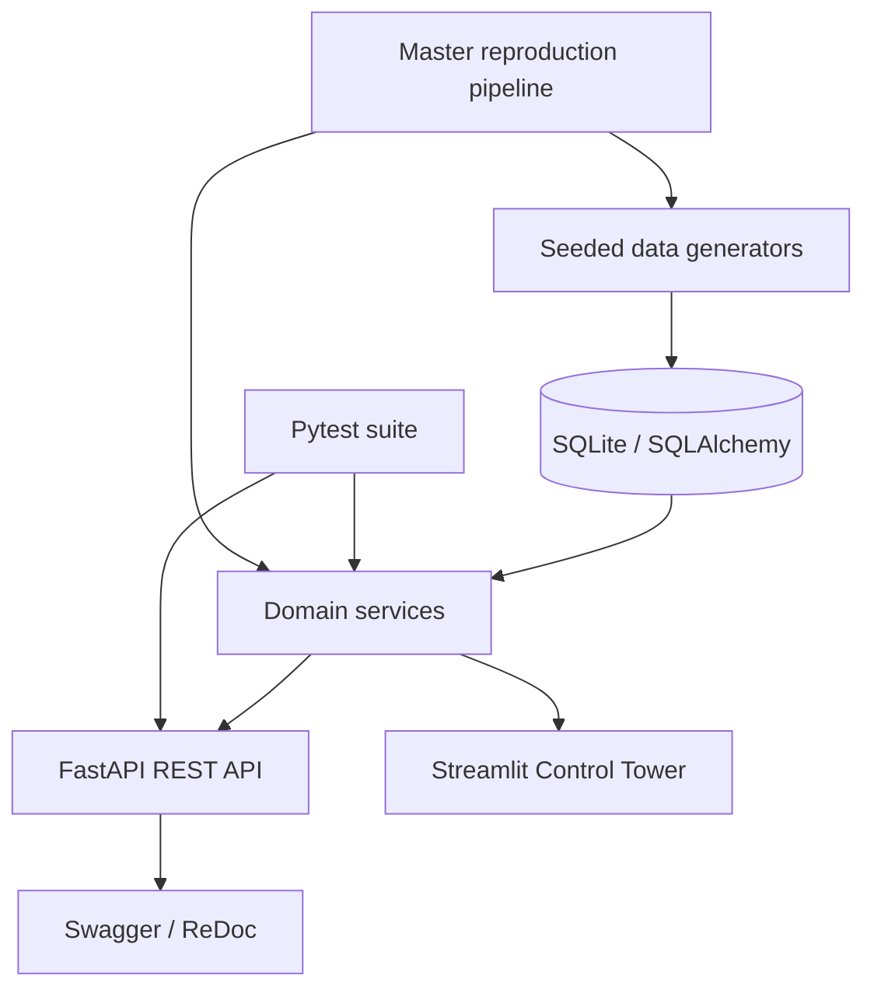

# Reverse Logistics & Asset Custody Control Tower

An end-to-end operations platform for reusable-asset lifecycle management. Track assets and shipments, reconstruct custody history, manage returns and inspections, reconcile deposits, and detect operational anomalies through a FastAPI backend and Streamlit dashboard.

> **Project data is synthetic.** Anomaly alerts are operational review signals, not proof of wrongdoing. Evaluation scores are measured against controlled anomalies inserted into the synthetic dataset and should not be interpreted as real-world performance.

## Product capabilities

| Area | What it provides |
|---|---|
| Executive overview | Fleet KPIs, active shipments, return volume, repair activity and deposit settlement summaries |
| Asset trajectory | Asset lookup, current recorded location, custodian and chronological chain-of-custody history |
| Reverse logistics | Return authorizations, inspection grades, repairs and deposit ledger visibility |
| Anomaly center | Five explainable operational rules, alert details and aggregate/per-rule metrics |
| REST API | Versioned endpoints, pagination, health checks and interactive OpenAPI documentation |
| Reproducibility | Seeded synthetic-data pipeline and automated regression tests |

## Dashboard

The Streamlit Control Tower is organized around four operational workspaces:

1. **Executive Overview** — fleet and operational KPIs with asset, shipment and financial summaries.
2. **Asset Trajectory Explorer** — choose an asset to inspect its custody history, current recorded location and movement map.
3. **Reverse Logistics & RMAs** — review returns, inspection grades, repair costs and deposit settlements.
4. **Anomaly Center & Metrics** — inspect rule-based alerts, confusion matrix and evaluation scorecard.

The dashboard uses a shared visual theme in `src/dashboard/theme.py` so that typography, spacing, navigation, metrics and data tables remain consistent.

## Screenshots

Add current screenshots to `docs/images/` and link them here after capturing them from the running application. Recommended captures:
- `overview.png` — Executive Overview
- `asset-trajectory.png` — Asset Trajectory Explorer
- `reverse-logistics.png` — Returns and inspections
- `anomaly-center.png` — Anomaly Center and metrics

## Architecture



The application separates persistence, domain services and user interfaces. Custody reconstruction, inspection grading, deposit settlement, anomaly detection and evaluation logic are implemented in service modules rather than duplicated in the dashboard.

See [System Architecture](docs/architecture.md), [Data Dictionary](docs/data_dictionary.md), [Design Decisions](DESIGN_DECISIONS.md), and [Deployment Guide](DEPLOYMENT.md).

## Technology stack

- **Language:** Python 3.11
- **Data:** Pandas, NumPy, Faker
- **Database / ORM:** SQLite, SQLAlchemy
- **API:** FastAPI, Pydantic, Uvicorn
- **Dashboard:** Streamlit
- **Testing:** Pytest, HTTPX
- **Version control:** Git and GitHub

## Quick start

### 1. Clone and install

```bash
git clone https://github.com/dheerajreddysaddi/reverse-logistics-tracker.git
cd reverse-logistics-tracker
python3.11 -m venv .venv
source .venv/bin/activate
python -m pip install --upgrade pip
python -m pip install -r requirements.txt
```

### 2. Generate or reproduce data

```bash
python -m scripts.reproduce_all --scale starter --seed 20261022
```

For the larger synthetic dataset:

```bash
python -m scripts.reproduce_all --scale full --seed 20261022
```

**Data safety:** the pipeline preserves existing records and does not automatically reset or delete the database. For a clean reproduction, use a separate empty database. Review the generator scripts before changing data-generation options.

### 3. Start the API

```bash
uvicorn src.api.main:app --reload
```

- API root: http://127.0.0.1:8000/
- Swagger UI: http://127.0.0.1:8000/docs
- ReDoc: http://127.0.0.1:8000/redoc
- Health check: http://127.0.0.1:8000/api/v1/health

### 4. Start the dashboard

In a second terminal, activate the same virtual environment:

```bash
cd reverse-logistics-tracker
source .venv/bin/activate
streamlit run src/dashboard/app.py
```

Streamlit normally opens at http://localhost:8501.

## API reference

All versioned routes use the `/api/v1` prefix.

| Method | Endpoint | Description |
|---|---|---|
| GET | `/api/v1/health` | Database connectivity and record counts |
| GET | `/api/v1/assets` | Paginated asset list; optional lifecycle and type filters |
| GET | `/api/v1/assets/{asset_identifier}` | Asset details by numeric ID or asset code |
| GET | `/api/v1/assets/{asset_identifier}/trajectory` | Reconstructed custody timeline |
| POST | `/api/v1/events` | Ingest a custody event |
| GET | `/api/v1/rmas` | Return authorizations |
| GET | `/api/v1/anomalies` | Detected operational anomalies |
| GET | `/api/v1/evaluation/metrics` | Aggregate and per-rule evaluation |

Interactive request and response schemas are available in Swagger at `/docs`.

## Inspection and deposit settlement

The inspection service computes a weighted score:

`Composite score = (Cosmetic × 0.4) + (Functional × 0.6)`

| Grade | Composite score | Condition | Action | Deposit outcome |
|---|---:|---|---|---:|
| A | >= 8.5 | Good | Restock | 100% refund |
| B | >= 6.5 | Good | Restock | 90% refund |
| C | >= 4.0 | Damaged | Refurbish | 50% refund |
| F | Below 4.0 | Unusable | Scrap | Full adjustment |

A zero-deposit case creates no refund or adjustment transaction.

## Anomaly rules

| Rule | Detection intent |
|---|---|
| ANOM-01 | Impossible travel speed between custody events |
| ANOM-02 | Receipt event without a shipment |
| ANOM-03 | Refund recorded before inspection |
| ANOM-04 | Refund amount exceeds the original deposit |
| ANOM-05 | Asset assigned to multiple active shipments |

Each alert includes a rule code, severity and supporting details so an operator can investigate the underlying record.

## Evaluation

The evaluation engine calculates TP, FP, TN, FN, accuracy, precision, recall, specificity and F1, including a per-rule breakdown.

The checked-in development benchmark currently documents 500 assets, 10 planted anomalies and 490 clean assets (TP=10, FP=0, FN=0, TN=490). The resulting 100% metrics describe only this controlled synthetic benchmark. The generator and detector are designed around the same known scenarios; these numbers do not demonstrate production or real-world anomaly-detection performance.

## Automated tests

Run:

```bash
pytest -v
```

Latest verified project run: **17 passed**, with two dependency deprecation warnings. The tests cover master data, deterministic identifiers, inspection grading, deposit settlement, custody reconstruction, evaluation and API endpoints.

## Repository structure

```text
reverse-logistics-tracker/
├── data/
│   ├── processed/
│   └── reverse_logistics.db
├── docs/
│   ├── architecture.md
│   └── data_dictionary.md
├── scripts/
│   └── reproduce_all.py
├── src/
│   ├── api/                 # FastAPI routes and schemas
│   ├── dashboard/           # Streamlit application and theme
│   ├── database/            # SQLAlchemy models and seeding
│   ├── generator/           # Synthetic operational data
│   └── services/            # Custody, returns, anomalies, evaluation
├── tests/
│   └── test_logistics.py
├── DESIGN_DECISIONS.md
├── DEPLOYMENT.md
├── README.md
└── requirements.txt
```

## Current local starter database

The last recorded local run contained:

| Entity | Records |
|---|---:|
| Reusable assets | 500 |
| Shipments | 254 |
| Custody events | 647 |
| Return authorizations | 100 |
| Inspections | 102 |
| Repairs | 24 |
| Deposit ledger entries | 101 |

These are snapshot counts from one local database, not fixed application limits.

## Operational notes

- Check whether port 8000 or 8501 is already in use before starting another server.
- Stop a development server with Ctrl+C in its own terminal.
- Do not commit virtual environments, local database files, generated private data or credentials.
- The documented deployment is local SQLite development. Public hosting requires persistent database configuration, secrets management and a security review.

## Interview walkthrough

**Problem:** Organizations need traceability across reusable assets, shipments, custody transfers, returns, inspections, repairs and deposits.

**Solution:** The platform centralizes lifecycle records, reconstructs custody timelines, applies inspection and settlement rules, and flags operational anomalies.

**Engineering:** SQLAlchemy and SQLite provide persistence; domain services implement business rules; FastAPI exposes REST endpoints; Streamlit presents operational views; Pytest validates key workflows.

**Important limitation:** The benchmark is synthetic and controlled. Alerts support human review; they are not proof of an actual operational violation.
