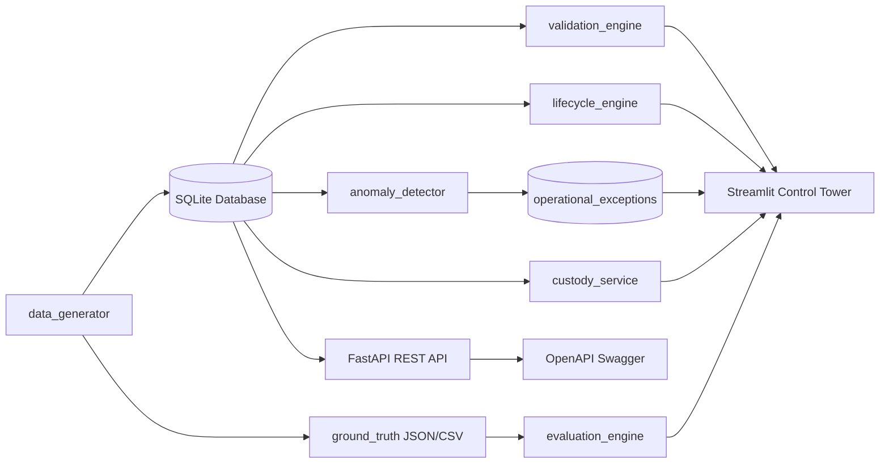
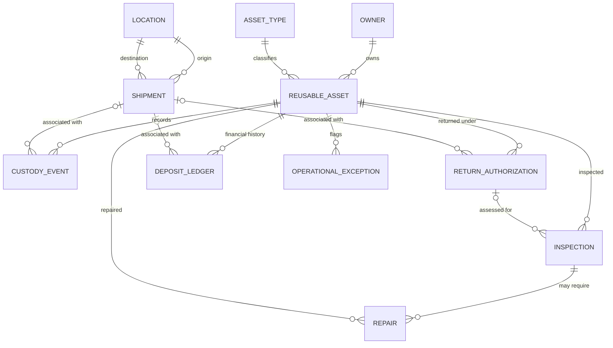

# Reverse Logistics & Asset Custody Control Tower

A working reverse logistics and asset custody control tower that tracks return merchandise, packaging, and custody transitions across locations; flags operational anomalies with explainable rules; and lets logistics operators record exception resolution decisions.

A flagged anomaly means **review recommended**, never operational fraud or intentional negligence proven.

All data is synthetic and generated locally using a fixed seed (`20261022`). No real commercial or personal data is used.

---

## Live Demo

**Live application:** [reverse-logistics-tracker.streamlit.app](https://reverse-logistics-tracker.streamlit.app/)

The app runs on Streamlit Community Cloud with automatic database bootstrapping.

### How to explore it

1. Open the live application. If it was idle, Streamlit may show a wake-up screen; wait a moment for it to start.
2. **Executive Control Tower:** see fleet-wide KPIs, active dispatches, asset condition breakdown, and deposit escrow balances.
3. **Asset Trajectory & GIS Map:** search any asset (e.g. `ASSET-0000001` or `AST-000001`) to view its chronological custody timeline and interactive GIS map between logistics hubs.
4. **Return & Repair Management:** review return authorizations (RMAs), turnaround aging, inspection grading (A/B/C/F), and repair cost telemetry.
5. **Exception Management Hub:** review flagged anomalies across the 5 mandatory edge cases and test the operator status resolution workflow (`Open` $\rightarrow$ `Under Review` $\rightarrow$ `Resolved`).
6. **Data Quality & Model Scorecard:** inspect the 12 automated integrity checks and benchmark detection against ground truth.
7. **Reports & Data Exports:** generate filtered CSV and JSON downloads.

### Demo notes

- All records are synthetic; no real enterprise or customer data is processed.
- Anomaly alerts indicate that operational triage is recommended.
- Evaluation metrics measure detection performance against known injected patterns in the synthetic benchmark dataset, not real-world warehouse logistics.
- If the hosted app is temporarily unavailable, follow the local setup instructions below.

---

## Features

- **Deterministic data generator:** seed `20261022`; starter mode creates 500 assets, 250 shipments, and 2,500 custody events; full scale mode expands to 20,000 assets, 10,000 shipments, and 100,000 events.
- **Normalized three-tier relational schema:** 10 core entities (`owners`, `locations`, `asset_types`, `reusable_assets`, `shipments`, `custody_events`, `return_authorizations`, `inspections`, `repairs`, `deposit_ledger`) plus `operational_exceptions`.
- **Append-only custody reconstruction:** point-in-time custody is reconstructed dynamically from chronological events, preserving complete audit trails without overwriting location columns.
- **Explainable operational anomaly rules:** detects the 5 mandatory reverse-logistics edge cases with structured root-cause evidence.
- **Double-entry deposit ledger:** tracks security deposits charged, refunded, and forfeited, preventing duplicate or premature refunds.
- **Diagnostic condition grading:** composite scoring evaluates cosmetic and functional inspection scores into Grades A, B, C, or F with automatic restock or repair dispatch.
- **Automated data validation engine:** 12 automated integrity checks verifying referential integrity, date ordering, foreign keys, lifecycle rules, and ledger balance.
- **Interactive operations dashboard:** 6 specialized operational workspaces with GIS route visualization.
- **REST API:** FastAPI service with OpenAPI Swagger documentation (`/docs`) for warehouse scanning and external ERP/WMS integration.
- **Automated test suite:** 30 unit and integration tests executing in under 2 seconds.
- **Deterministic reproducibility & export:** Bit-for-bit SHA-256 reproducibility engine across all 11 tables and complete CSV, JSON, and SQL seed dumps.
- **Formal acceptance report:** Comprehensive requirement-by-requirement audit in [`FINAL_ACCEPTANCE_REPORT.md`](FINAL_ACCEPTANCE_REPORT.md).

---

## Architecture



The anomaly detector reads database tables and writes explainable findings to `operational_exceptions`. Only the evaluation module reads the ground-truth answer key, strictly after detection runs.

---

## Entity Relationships



Foreign keys are strictly enforced by the relational schema (`PRAGMA foreign_keys = ON;`). Detailed entity attributes, constraints, and lifecycle transitions are documented in [`docs/data_dictionary.md`](docs/data_dictionary.md) and [`docs/schema.md`](docs/schema.md).

---

## Technology Stack

- **Python 3.11:** runtime environment.
- **Streamlit:** operations dashboard and presentation tier.
- **FastAPI & Uvicorn:** high-performance asynchronous REST API.
- **SQLAlchemy:** relational ORM and SQL expression engine.
- **SQLite (WAL Mode):** local persistent transactional storage.
- **Pydantic v2:** request/response schema validation.
- **Folium & Plotly:** interactive GIS route mapping and metric charts.
- **Pytest:** automated unit and integration testing suite.

---

## Operational Exception Rules

The platform implements five explicit, explainable operational exception rules:

| Rule ID | Issue Type | Category | Detection Logic | Severity | Expected Operator Action |
|---|---|---|---|---|---|
| **ANOM-01** | `MULTIPLE_ACTIVE_LOCATIONS` | Physical / Spatial | Haversine velocity $> 600\text{ mph}$ between consecutive scans, or concurrent active shipments. | `CRITICAL` | `QUARANTINE_ASSET` |
| **ANOM-02** | `RETURN_BEFORE_DISPATCH` | Process / Ordering | RMA intake or request timestamp precedes the original shipment dispatch date. | `HIGH` | `HOLD_RETURN_INTAKE` |
| **ANOM-03** | `DUPLICATE_REFUND` | Financial / Ledger | Multiple refunds issued for the same deposit, refund without inspection, or refund exceeding deposit. | `CRITICAL` | `FREEZE_LEDGER_TRANSACTION` |
| **ANOM-04** | `REPAIR_WITHOUT_INSPECTION` | Compliance / Quality | Repair work order opened or completed without a preceding diagnostic intake inspection. | `MEDIUM` | `REOPEN_INSPECTION_WORKFLOW` |
| **ANOM-05** | `MISSING_CUSTODY_ACTOR` | Audit / Accountability | Custody handoff or physical scan recorded without an authorized operator identifier. | `MEDIUM` | `REASSIGN_CUSTODY_AUDITOR` |

Operators can review exceptions, update resolution status (`Open` $\rightarrow$ `Under Review` $\rightarrow$ `Resolved`), and append audit resolution notes directly within the **Exception Management Hub**.

---

## Evaluation & Benchmarks

The evaluation unit is the physical asset (500 assets in starter mode, 20,000 in full scale).

- **Precision** = $\frac{\text{TP}}{\text{TP} + \text{FP}}$
- **Recall** = $\frac{\text{TP}}{\text{TP} + \text{FN}}$
- **F1-Score** = $\frac{2 \times \text{Precision} \times \text{Recall}}{\text{Precision} + \text{Recall}}$
- **Specificity** = $\frac{\text{TN}}{\text{TN} + \text{FP}}$

### Benchmark Results (Seed: `20261022`, Starter Scale: 500 Assets)

| Metric | Rule ANOM-01 | Rule ANOM-02 | Rule ANOM-03 | Rule ANOM-04 | Rule ANOM-05 | Overall System |
|---|---:|---:|---:|---:|---:|---:|
| **True Positives (TP)** | 2 | 2 | 2 | 2 | 2 | **10** |
| **False Positives (FP)** | 0 | 0 | 0 | 0 | 0 | **0** |
| **False Negatives (FN)** | 0 | 0 | 0 | 0 | 0 | **0** |
| **True Negatives (TN)** | 498 | 498 | 498 | 498 | 498 | **490** |
| **Precision** | 1.000 | 1.000 | 1.000 | 1.000 | 1.000 | **1.000** |
| **Recall** | 1.000 | 1.000 | 1.000 | 1.000 | 1.000 | **1.000** |
| **F1-Score** | 1.000 | 1.000 | 1.000 | 1.000 | 1.000 | **1.000** |
| **Specificity** | 1.000 | 1.000 | 1.000 | 1.000 | 1.000 | **1.000** |

*Note on Interpretation:* These results compare detection output with synthetic anomaly labels deliberately injected into generated records. They verify that the detection logic reliably identifies the target edge cases under controlled conditions; they do not establish detection performance on live, unstructured logistics telemetry.

---

## Known Limitations

- **Heuristic Travel Thresholds:** The 600 mph velocity threshold detects impossible movement but does not account for specific airline hub schedules or regional road speed limits.
- **Demo Identity Management:** The current implementation uses session-based operator names for audit logging. Enterprise deployment requires SSO integration (OAuth2/OIDC).
- **Relational Storage:** SQLite in WAL mode is configured for lightweight, zero-dependency local evaluation. High-throughput production deployments require migration to a distributed relational database (e.g. PostgreSQL).
- **Synthetic Ground Truth:** Synthetic anomaly labels reflect known injected patterns rather than messy, ambiguous real-world return discrepancies.

---

## AI Usage and Data Provenance

- See [`AI_USAGE.md`](AI_USAGE.md) for transparent disclosure of AI assistance and prompt history.
- See [`docs/source_manifest.md`](docs/source_manifest.md) for complete data provenance and software licensing.
- See [`DESIGN_DECISIONS.md`](DESIGN_DECISIONS.md) for architectural trade-offs and rationale.

AI tools supported parts of the development process. All architectural decisions, data models, business rules, validation checks, and test results were evaluated, implemented, and verified by the author.

---

## Quickstart & Local Setup

### 1. Environment Setup
```bash
# Clone repository
git clone https://github.com/dheerajreddysaddi/reverse-logistics-tracker.git
cd reverse-logistics-tracker

# Create and activate virtual environment
python3.11 -m venv .venv
source .venv/bin/activate

# Install dependencies
python -m pip install --upgrade pip
python -m pip install -r requirements.txt
```

### 2. Reproduce Deterministic Dataset & Run Benchmarks
```bash
# Starter mode (500 assets, seed=20261022)
python -m scripts.reproduce_all --scale starter --seed 20261022

# Optional: Full enterprise scale (20,000 assets, 10,000 shipments, 100,000 events)
python -m scripts.reproduce_all --scale full --seed 20261022
```

### 3. Run Automated Tests
```bash
pytest tests/test_logistics.py -v
```
All 30 unit and integration tests pass in under 2 seconds.

### 4. Verify Reproducibility & Export Data
```bash
# Verify bit-for-bit SHA-256 reproducibility across 2 isolated runs
python -m scripts.reproducibility

# Export all 11 tables to CSV, JSON, and SQL seed script
python -m scripts.export_all
```

### 5. Launch REST API
```bash
uvicorn src.api.main:app --reload --host 127.0.0.1 --port 8000
```
- Interactive Swagger UI: [http://127.0.0.1:8000/docs](http://127.0.0.1:8000/docs)
- Health check: [http://127.0.0.1:8000/api/v1/health](http://127.0.0.1:8000/api/v1/health)

### 6. Launch Operations Control Tower
```bash
streamlit run src/dashboard/app.py
```
Opens in your browser at [http://localhost:8501](http://localhost:8501) (or `http://127.0.0.1:8501`).

---

## Troubleshooting

| Problem | Root Cause | Solution |
|---|---|---|
| `Safari can't connect to server` | Safari defaults to `https://` or attempts IPv6 `::1` resolution on `localhost`. | Open `http://127.0.0.1:8501` directly with explicit `http://`, or use Google Chrome. |
| `Port 8501 is busy` | A previous Streamlit process is still listening. | Run `lsof -i :8501` to find PID, then `kill -9 <PID>`. |
| `Port 8000 is busy` | A previous FastAPI/Uvicorn process is listening. | Run `lsof -i :8000` to find PID, then `kill -9 <PID>`. |
| `ModuleNotFoundError` | Virtual environment is not activated or packages are uninstalled. | Run `source .venv/bin/activate` followed by `pip install -r requirements.txt`. |
| `pyarrow / NumPy warning` | Minor version mismatch between binary packages. | Dependencies are pinned in `requirements.txt`; run `pip install -r requirements.txt`. |
| Hosted app waking up slowly | Streamlit Community Cloud spins down idle containers. | Wait 30 seconds for the container to initialize and refresh once. |
