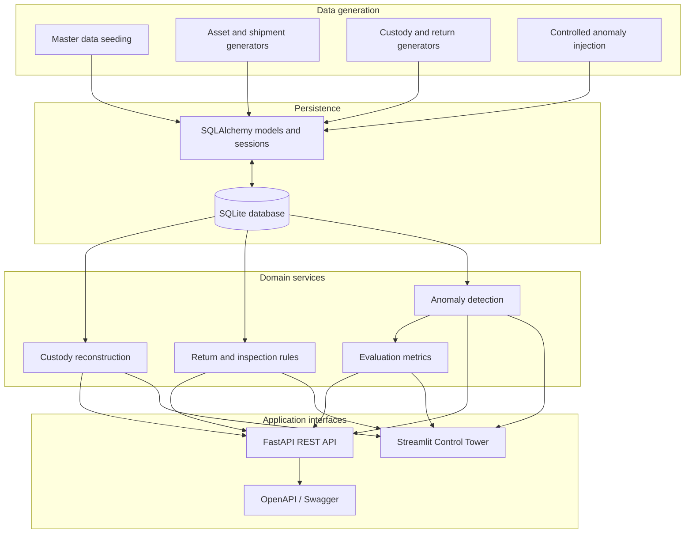

# System Architecture

## Overview

Reverse Logistics Tracker is a layered Python application for reusable-asset lifecycle visibility. It combines deterministic synthetic-data generation, a relational database, domain services, a REST API and a Streamlit operations dashboard.

## Layer responsibilities

| Layer | Location | Responsibility |
|---|---|---|
| Generators | `src/generator/` | Create deterministic synthetic master and operational records |
| Database | `src/database/` | SQLAlchemy entities, connection/session management and master-data seeding |
| Domain services | `src/services/` | Custody history, inspection grading, deposit settlement, anomaly rules and evaluation |
| REST API | `src/api/` | Versioned HTTP endpoints, request validation and response schemas |
| Dashboard | `src/dashboard/` | Operational views for fleet, asset movement, returns, and anomaly metrics |
| Tests | `tests/` | Domain and API regression checks |
| Reproduction | `scripts/reproduce_all.py` | Runs the complete data-generation and evaluation sequence |

## Main operational flow

1. Seed owners, locations and asset types.
2. Generate reusable assets, shipments and custody events.
3. Generate return authorizations, inspections, repairs and deposit-ledger entries.
4. Apply the controlled anomaly scenarios used by the synthetic benchmark.
5. Run the five anomaly rules and produce evaluation metrics.
6. Explore the records through the Streamlit dashboard or FastAPI endpoints.

## API contract

The API is versioned under `/api/v1`. Interactive documentation is served at `/docs`; ReDoc is served at `/redoc`.

| Method | Route | Purpose |
|---|---|---|
| GET | `/api/v1/health` | Database connectivity and core record counts |
| GET | `/api/v1/assets` | Paginated assets, with optional filters |
| GET | `/api/v1/assets/{asset_identifier}` | Asset detail by ID or asset code |
| GET | `/api/v1/assets/{asset_identifier}/trajectory` | Reconstructed custody history |
| POST | `/api/v1/events` | Create a custody event |
| GET | `/api/v1/rmas` | Return authorizations |
| GET | `/api/v1/anomalies` | Detected anomaly records |
| GET | `/api/v1/evaluation/metrics` | Aggregate and per-rule evaluation |

## Design boundaries

- The database is the persisted source of operational records.
- The detector evaluates operational records against controlled synthetic anomaly markers; benchmark results are not evidence of real-world detection performance.
- The dashboard is a presentation layer; domain calculations remain in service modules.
- The reproduction pipeline preserves existing records and does not reset the database.
