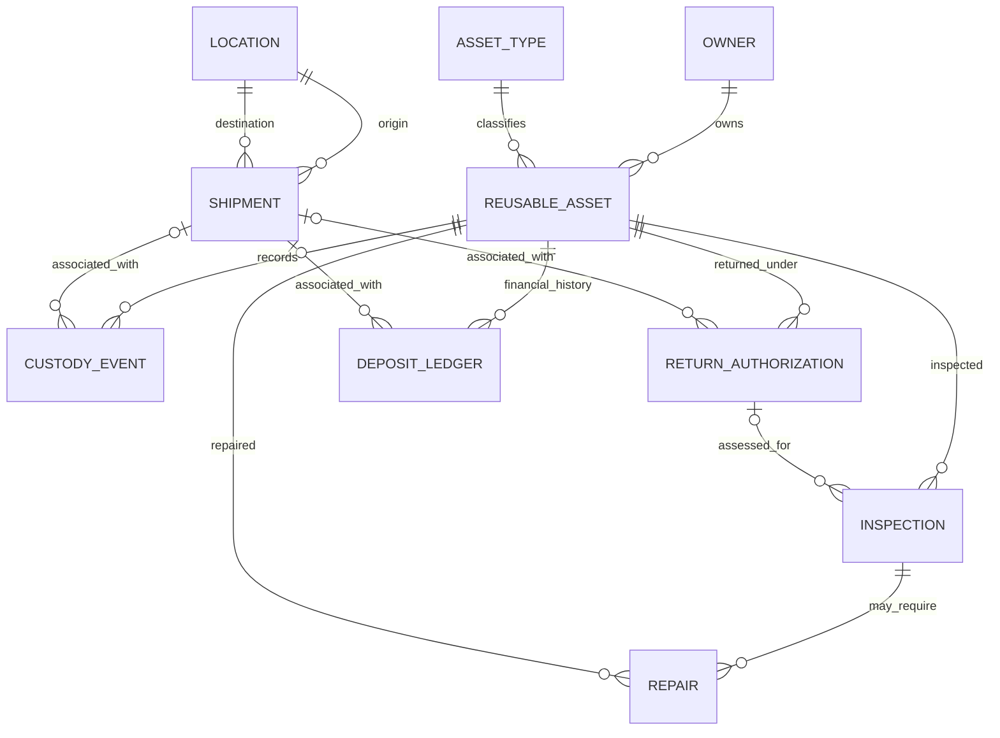

# Data Dictionary

The following entities are implemented as SQLAlchemy models in `src/database/models.py`. Primary keys are integer identifiers unless otherwise noted. Foreign-key relationships are enforced by the relational schema.

## Entity summary

| Entity / table | Purpose | Important relationships |
|---|---|---|
| Owner / `owners` | Organization that owns reusable assets | One owner has many assets |
| Location / `locations` | Warehouse, distribution centre, supplier or customer location | Origin/destination of shipments; source/destination of custody events |
| AssetType / `asset_types` | Reusable asset category and its deposit/return policy | One type has many assets |
| ReusableAsset / `reusable_assets` | Individually tracked reusable unit | Belongs to an owner and asset type; has events, returns, inspections, repairs and ledger entries |
| Shipment / `shipments` | Movement of assets between two locations | Has origin/destination locations and related events, returns and ledger entries |
| CustodyEvent / `custody_events` | Timestamped custody or movement event | Belongs to an asset; optionally references a shipment; references destination and optional source location |
| ReturnAuthorization / `return_authorizations` | Request to return an asset | Belongs to an asset; optionally references a shipment; has inspections |
| Inspection / `inspections` | Condition assessment of a returned asset | Belongs to an asset and optionally a return authorization; may have repairs |
| Repair / `repairs` | Repair work and cost | Belongs to an asset and an inspection |
| DepositLedger / `deposit_ledger` | Deposit charge, refund or adjustment transaction | Belongs to an asset; optionally references a shipment |

## Important fields and constraints

### Owners
- `owner_id`: primary key.
- `owner_name`: required and unique.
- `owner_type`: required.
- `contact_email`: optional.
- `is_active`: required boolean, defaults to true.

### Locations
- `location_id`: primary key.
- `location_name`, `location_type`, `city`, `state`, `country`: required.
- `is_active`: required boolean, defaults to true.

### Asset types
- `asset_type_id`: primary key.
- `type_name`: required and unique.
- `expected_return_days`: positive integer.
- `deposit_amount`: non-negative decimal amount.
- `description`, `is_active`: optional description and active flag.

### Reusable assets
- `asset_id`: primary key.
- `asset_code`: required and unique business identifier.
- `asset_type_id`, `owner_id`: required foreign keys.
- `serial_number`, `manufacture_date`: optional.
- `lifecycle_status`: one of `available`, `in_transit`, `in_use`, `under_repair`, `lost`, `retired`.
- `created_at`: required timestamp.

### Shipments
- `shipment_id`: primary key; `shipment_code` is unique.
- `origin_location_id`, `destination_location_id`: required location foreign keys and must differ.
- `carrier_name`, `dispatch_date`, `shipment_status`: required.
- `expected_delivery_date`, `actual_delivery_date`: optional.
- Status is one of `planned`, `dispatched`, `delivered`, `cancelled`.

### Custody events
- `event_id`: primary key.
- `asset_id`, `to_location_id`: required foreign keys.
- `shipment_id`, `from_location_id`: optional foreign keys.
- `actor_name`, `event_type`, `event_timestamp`: required.
- Event type is one of `dispatch`, `transfer`, `receipt`, `return`.
- `notes`: optional. Events are indexed by asset and timestamp for trajectory retrieval.

### Return authorizations
- `return_id`: primary key; `return_code` is unique.
- `asset_id`, `requested_by`, `request_date`, `return_status`: required.
- `shipment_id`, `approved_date`: optional.
- Status is one of `requested`, `approved`, `received`, `rejected`, `cancelled`.

### Inspections
- `inspection_id`: primary key.
- `asset_id`, `inspector_name`, `inspection_date`, `condition_status`: required.
- `return_id`, `remarks`: optional.
- Condition is one of `good`, `damaged`, `unusable`.

### Repairs
- `repair_id`: primary key.
- `asset_id`, `inspection_id`, `repair_description`, `repair_cost`, `repair_status`, `opened_at`: required.
- `closed_at`: optional.
- Cost must be non-negative; status is one of `open`, `in_progress`, `completed`.

### Deposit ledger
- `ledger_id`: primary key.
- `asset_id`, `transaction_type`, `amount`, `transaction_date`, `reference_code`: required.
- `shipment_id`, `notes`: optional.
- Reference code is unique; amount must be greater than zero; transaction type is `charge`, `refund` or `adjustment`.

## Entity relationship diagram

